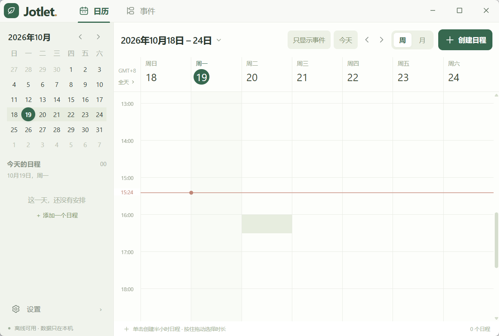
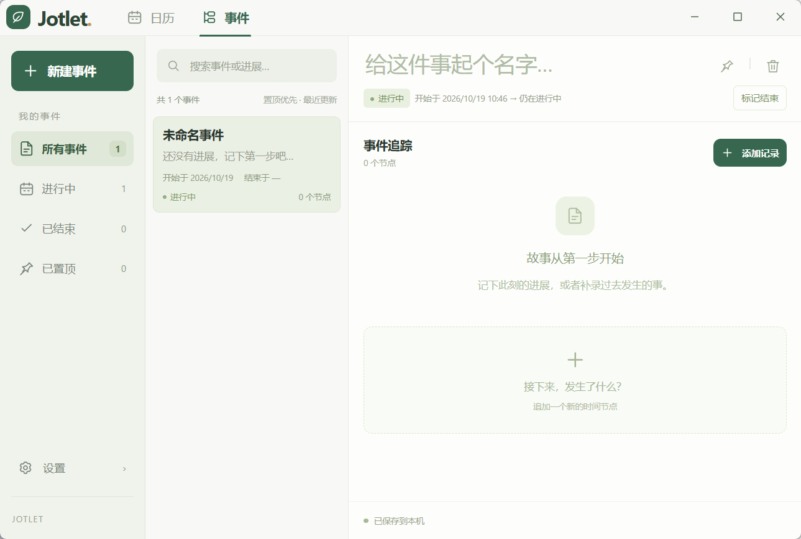
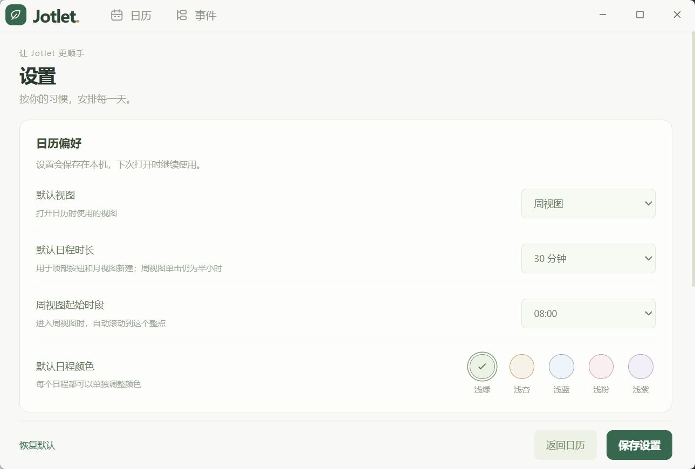
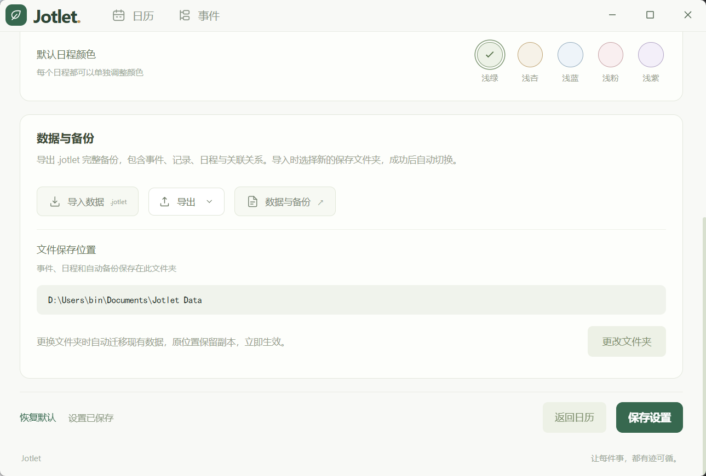

<p align="center">
  
</p>

<h1 align="center">Jotlet · 随手记</h1>

<p align="center">让每件事，都有迹可循。</p>

<p align="center">
  <a href="https://github.com/wee-b/Jotlet/releases/latest">下载 Windows 安装包</a>
  · <a href="#界面预览">界面预览</a>
  · <a href="#本地开发">本地开发</a>
  · <a href="LICENSE">非商业许可证</a>
</p>

Jotlet 是一个保存在本机的日历与事件追踪桌面应用。用日历安排时间，用事件串起每一步记录，无需账号、后端或云服务。

基于 Electron、TypeScript 和 Vite，当前提供 **Windows x64** 安装包。项目源码可见，采用 **PolyForm Noncommercial 1.0.0** 许可证，**仅限非商业用途**。

## 功能

- **周／月日历**：默认周视图，支持迷你月历、日期跳转、前后翻页和回到今天。周视图只画整点线，单击选择半小时，按住向下拖动可选择更长时间；靠近边缘自动滚动，按 Esc 取消。
- **独立或关联日程**：日程可独立保存，也可绑定已有事件；创建并绑定新事件时，自动添加一条包含日程主题、描述及开始时间的初始记录。已关联日程直接显示事件名称。
- **全天日程与颜色**：提供五种浅色日程颜色。全天区域无日程时默认收起，有日程时默认展开，也可手动折叠。
- **事件追踪**：按事件整理进展，支持置顶、搜索、开始／结束时间，以及记录的追加、编辑和删除；记录按发生时间排列，可补录过去的进展。
- **本地数据与备份**：完整导出 `.jotlet` 文件，保留事件、记录、日程、颜色和关联关系。在设置中选择文件或拖入备份，解析预览后取消、合并或覆盖；Windows 安装时注册 `.jotlet` 文件关联，双击文件会先询问是否导入。
- **个人偏好**：在左下角「设置」中调整默认视图、日程时长、颜色和周视图起始时段，也可管理数据、备份和保存位置。
- **小窗口适配**：默认及最小窗口为 860 × 580，支持放大。紧凑工具栏、独立滚动区域和底部操作适配小尺寸；月历放不下的日程通过「还有 N 个日程」查看。

日历顶部的「只显示事件／全部显示」可筛选已关联现有事件的日程。删除日程不影响事件；删除事件不会连带删除日程，原日程将不再显示有效的事件关联。

## 界面预览

| 日历周视图                          | 事件追踪                          |
| ----------------------------------- | --------------------------------- |
|  |  |

| 日历偏好设置                              | 数据与备份                                  |
| ----------------------------------------- | ------------------------------------------- |
|  |  |

## 下载与安装

前往 [GitHub Releases](https://github.com/wee-b/Jotlet/releases/latest)，下载 `Jotlet-1.0.1-Setup.exe`。Release 同时提供 `SHA256SUMS.txt` 供校验。

1. 关闭正在运行的 Jotlet，打开安装包。
2. 首页选择「安装 Jotlet」或「卸载 Jotlet」。未检测到已安装版本时，卸载选项不可选；支持识别旧版 Squirrel 的卸载入口。
3. 选择安装后，阅读并接受非商业许可条款，分别选择**程序安装目录**和**数据保存目录**。两个目录应相互独立，不能互相包含。
4. 安装完成后启动应用。首次启动会使用选择的数据目录；如果已有数据需要迁移，会保留原位置副本。目标与当前位置都有数据时，拒绝自动覆盖。

安装面向当前 Windows 用户，请选择有写入权限的目录。卸载会保留数据文件夹和用户设置，只移除程序文件、快捷方式及卸载注册项。旧版 Squirrel 用户可先从向导卸载旧程序，再安装新版。

校验安装包（PowerShell）：

```powershell
Get-FileHash -Algorithm SHA256 '.\Jotlet-1.0.1-Setup.exe'
```

将输出与 `SHA256SUMS.txt` 中同名文件的值比较。

## 数据保存与迁移

所有数据在本机读写，生产应用阻止外部网络请求。数据未加密，备份也包含完整内容。

| 文件／格式            | 用途                                                 |
| --------------------- | ---------------------------------------------------- |
| `notes.json`          | 事件与记录的定期快照                                 |
| `calendar.json`       | 日程、颜色和事件关联的定期快照                       |
| `*.json.journal`      | 快照之后的增量变更，与对应 JSON 共同组成当前数据     |
| `active-dataset.json` | 导入后指向当前使用的数据批次，事件和日历一起切换     |
| `.jotlet-datasets/`   | 导入的数据批次，保留旧批次文件供恢复                 |
| `*.bak`               | 已有备份及旧版日历迁移前的原始文件，不再每次写入复制 |
| `notes.json.v1.bak`   | 旧版记录迁移为事件前保留的原始文件                   |
| `.jotlet`             | 可导入的完整备份，包含事件和日程                     |

- **导入和导出仅支持 `.jotlet` 完整备份**，不设文件大小上限。导入仅接受单个文件，不支持 `.json`、`.md`、`.txt` 或 `.jetlet`；仍会校验备份格式与内容。
- 导出会检查真实文件位置，禁止通过目录别名或文件链接覆盖正在使用的数据；先写入并刷盘临时文件，再整体替换目标，失败时保留原备份。
- 普通保存只将变更的事件或日程追加到增量日志，删除写入删除标记，不再重写完整数据集或复制旧文件。日志达到 4 MiB 且不小于快照时，在下一次写入前合并快照，以控制日志增长。启动时恢复快照与已提交日志，末尾未写完的变更不生效。
- 手动复制时请保留整个数据目录，包括 JSON、对应的 `.journal`、`active-dataset.json` 和 `.jotlet-datasets/`（若存在）；跨设备恢复推荐使用 `.jotlet` 完整备份，导出时自动包含最新变更。
- 在「设置 → 数据与备份 → 解析与导入」选择文件或拖入单个 `.jotlet` 文件，点击「开始解析」。结果展示备份时间、事件／记录／日程数量、内容列表及合并时的重复和冲突统计，解析和取消均不会更改数据。
- **合并导入**：保留本地内容，跳过重复内容，同 ID 的不同内容另存一份，并修正日程关联；引用备份之外事件的日程作为独立日程导入。**覆盖当前数据**：再次确认后替换整套事件和日历，原数据文件保留。两种模式都继续使用当前保存文件夹，先准备新批次，再一次切换，失败时保留原数据。
- 如果本地事件或日程快照／日志损坏，仍可在设置中解析 `.jotlet` 备份；此时不能合并，可在确认覆盖后恢复完整数据，损坏文件会保留。
- Windows 安装时为当前用户注册 `.jotlet` 文件类型、图标和打开命令。双击文件会启动或唤起 Jotlet，确认「要导入此文件吗？」后打开解析窗口；此时仍需选择合并或覆盖才会修改数据。卸载移除本程序的关联，并保留其他程序的关联设置。
- 在「设置 → 数据与备份」可更换数据目录。迁移成功后立即生效，原位置保留副本；设置中选择的新位置在后续启动时继续使用。
- 数据位置记录在 Electron 用户配置目录的 `data-location.json` 中；未使用安装向导时，默认直接使用该用户目录。目录不可访问或数据损坏时会提示错误，不会静默重置数据。
- 换设备或重装前，先导出 `.jotlet` 完整备份；需要恢复时，再通过设置页导入。

## 快捷键

| 快捷键           | 日历页面               | 事件页面         |
| ---------------- | ---------------------- | ---------------- |
| `Ctrl / Cmd + N` | 创建日程               | 新建事件         |
| `Ctrl / Cmd + K` | —                      | 搜索事件与记录   |
| `Ctrl / Cmd + S` | —                      | 立即保存事件名称 |
| `Esc`            | 取消时间拖选／关闭弹窗 | 关闭弹窗         |

事件名称停止输入后自动保存；记录在点击「保存记录」后写入。新建日程时显式点击「创建并绑定」会立即创建事件及初始记录，即使随后取消日程，这部分已保存内容仍会保留。

## 本地开发

需要 **Node.js 22.13+** 与 npm。Windows 安装包需在 Windows 上构建。

```sh
npm ci
npm start
```

| 命令                     | 作用                                                        |
| ------------------------ | ----------------------------------------------------------- |
| `npm run lint`           | 代码与格式检查                                              |
| `npm run typecheck`      | TypeScript 类型检查                                         |
| `npm run check`          | 一次运行类型、代码格式与单元测试检查                        |
| `npm test`               | 数据、日历交互、迁移和安装配置测试                          |
| `npm run test:installer` | 隔离测试安装／卸载、中文路径、目录冲突和数据保留（Windows） |
| `npm run icons`          | 从矢量源文件生成应用图标                                    |
| `npm run package`        | 生成当前平台应用目录                                        |
| `npm run make`           | 生成发行安装包                                              |

Windows 安装包输出到 `out/make/nsis/x64/`。首次构建会下载 NSIS 3.12，并校验固定的 SHA-256，编译器缓存在 `.cache/nsis-3.12`。安装器测试仅使用临时目录和独立注册表键，不操作正式安装的数据。

目录结构：

```text
src/
  main/                 Electron 启动、窗口与 IPC
    storage/            文件读写、数据目录迁移和安装配置
  preload/              向页面暴露受限的桌面 API
  shared/               事件、日程、备份格式及 API 类型
  renderer/
    app.ts              页面装配与导航
    components/         导航栏、窗口按钮、图标和提示层
    pages/
      calendar/         周／月视图、时间拖选和日程编辑
      events/           事件列表、记录编辑和时间线
      settings/         偏好设置、导入导出和保存位置
    styles/             全局样式与应用外壳
    utils/              前端共用的小工具
build/                  Electron Forge 的 NSIS 构建扩展
installer/              Windows 安装／卸载向导
scripts/                图标生成与安装器测试
tests/                  数据、交互和迁移测试
assets/                 应用图标
```

页面各自管理模板、样式和交互，跨页面操作由 `renderer/app.ts` 连接。`shared` 保持为纯 TypeScript，不依赖 Electron、文件系统或页面 DOM；前端通过 preload API 访问本地数据，不直接导入主进程模块。

修改数据格式或保存流程时，先补充对应的 `tests/*.test.ts`，再运行 `npm run check`。涉及窗口、preload 或构建入口的改动还需运行 `npm run package`；涉及安装流程时运行 `npm run test:installer`。

## 许可证

本项目采用 [PolyForm Noncommercial License 1.0.0](LICENSE)。允许在许可范围内进行非商业使用、学习、修改及再分发；未经权利人另行授权，不得用于商业目的，包括商业销售、收费服务或商业产品集成。

这是**源码可见、限制商业用途**的许可，不属于 [OSI 定义的开源许可证](https://opensource.org/osd)。许可原文及非商业用途的具体范围以 [LICENSE](LICENSE) 为准，版权及分发声明见 [NOTICE](NOTICE)。许可变更不追溯撤销历史副本已经获得的有效授权。

Electron、Chromium、Node.js、NSIS 及其他第三方组件保留各自的许可证。Jotlet 的非商业限制仅适用于本项目权利人拥有的内容，不改变第三方组件的许可。
